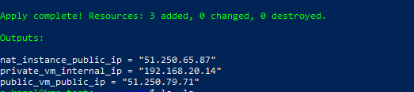

# Домашнее задание к занятию «Организация сети»

## Задание 1. Создание VPC, NAT-инстанса и приватной сети

### Terraform-конфигурация (`main.tf`)


```hcl
terraform {
  required_providers {
    yandex = {
      source = "yandex-cloud/yandex"
    }
  }
  required_version = ">= 0.13"
}

provider "yandex" {
  zone = "ru-central1-a" 
  service_account_key_file = ".key.json"
}

variable "folder_id" { type = string }
variable "ssh_key_path" { type = string } 

# 1. Создаём сеть VPC
resource "yandex_vpc_network" "my-vpc" {
  name = "my-vpc"
}

resource "yandex_vpc_subnet" "public" {
  name           = "public"
  zone           = "ru-central1-a"
  network_id     = yandex_vpc_network.my-vpc.id
  v4_cidr_blocks = ["192.168.10.0/24"]
}

resource "yandex_vpc_subnet" "private" {
  name           = "private"
  zone           = "ru-central1-a"
  network_id     = yandex_vpc_network.my-vpc.id
  v4_cidr_blocks = ["192.168.20.0/24"]
  route_table_id = yandex_vpc_route_table.nat-route.id
}

resource "yandex_vpc_route_table" "nat-route" {
  name       = "nat-route"
  network_id = yandex_vpc_network.my-vpc.id

  static_route {
    destination_prefix = "0.0.0.0/0"
    next_hop_address   = "192.168.10.254" 
  }
}

resource "yandex_compute_instance" "nat-instance" {
  name        = "nat-instance"
  platform_id = "standard-v2"
  zone        = "ru-central1-a"
  allow_stopping_for_update = true

  resources {
    cores  = 2
    memory = 2
  }

  boot_disk {
    initialize_params {
      image_id = "fd80mrhj8fl2oe87o4e1"
    }
  }

  network_interface {
    subnet_id = yandex_vpc_subnet.public.id
    nat       = true # Включаем публичный IP
    ip_address = "192.168.10.254" 
  }

  metadata = {
    ssh-keys = "ubuntu:${file(var.ssh_key_path)}"
  }
}

resource "yandex_compute_instance" "public-vm" {
  name        = "public-vm"
  platform_id = "standard-v2"
  zone        = "ru-central1-a"

  resources {
    cores  = 2
    memory = 2
    core_fraction = 20
  }

  boot_disk {
    initialize_params {
      image_id = "fd80mrhj8fl2oe87o4e1" 
    }
  }

  network_interface {
    subnet_id = yandex_vpc_subnet.public.id
    nat       = true
  }

  metadata = {
    ssh-keys = "ubuntu:${file(var.ssh_key_path)}"
  }
}

resource "yandex_compute_instance" "private-vm" {
  name        = "private-vm"
  platform_id = "standard-v3"
  zone        = "ru-central1-a"

  resources {
    cores  = 2
    memory = 2
    core_fraction = 20
  }

  boot_disk {
    initialize_params {
      image_id = "fd80mrhj8fl2oe87o4e1"
    }
  }

  network_interface {
    subnet_id = yandex_vpc_subnet.private.id
    nat       = false 
  }

  metadata = {
    ssh-keys = "ubuntu:${file(var.ssh_key_path)}"
  }
}

output "nat_instance_public_ip" {
  value = yandex_compute_instance.nat-instance.network_interface.0.nat_ip_address
}
output "public_vm_public_ip" {
  value = yandex_compute_instance.public-vm.network_interface.0.nat_ip_address
}
output "private_vm_internal_ip" {
  value = yandex_compute_instance.private-vm.network_interface.0.ip_address
}
```

### Результат выполнения terraform apply



### Подключение и проверка доступа в интернет с публичной ВМ

